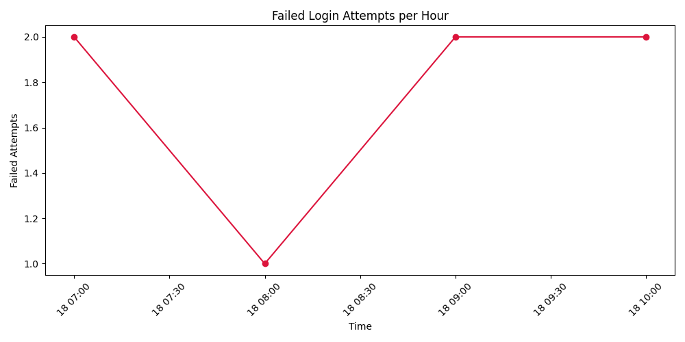

# Security Log Visualizer

A small exercise I made to parse failed SSH login messages and plot the number of attempts per hour. I’m keeping it as an early Python project rather than developing it into a monitoring tool.



## Run it

Install Python and matplotlib, then run from the repository root:

```bash
python -m pip install -r requirements.txt
python src/parse_failed_logins.py --year 2025
```

The included log is fictional. You can choose another input file with `--input PATH` and another plot location with `--output PATH`. The year is required because these syslog lines do not contain one.

## Limits

This handles one traditional SSH failed-password log format. It does not handle journald JSON, timezone conversion, year rollover, live collection or alerting. An empty or unreadable input produces an error instead of an empty chart.

MIT license.
